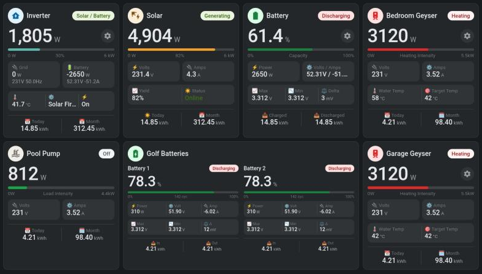

# Energy Tile Card



A universal Home Assistant dashboard card for any power or energy device: inverters, solar, batteries, smart plugs, heaters, EV chargers. It works with any sensors and is built entirely in the visual editor. Each tile has:

- a header with an icon, a name and a **status pill** driven by rules
- one **big value**, with an optional cog button that opens a pop-up (for example a bubble-card `#hash`)
- a **progress bar**
- **rows of stat boxes**, as separate boxes or one split box
- a **Today / Month footer**

Pick your sensors in the editor and the card fills in the rest. Units come from the sensor, labels default to the entity name, and decimals follow the sensor's display precision.

The card is plain JavaScript with no dependencies. It redraws only when one of its own entities changes, and all tiles on a page share one stylesheet, so it stays light on wall tablets.

## Installation

### HACS (recommended)

1. In HACS, open the **⋮** menu and choose **Custom repositories**.
2. Add `https://github.com/Virmin8/energy-tile-card` with the type **Dashboard**.
3. Search for **Energy Tile Card**, install it, and reload the browser.

HACS adds the dashboard resource for you.

### Manual

1. Copy `energy-tile-card.js` to `/config/www/`.
2. Go to **Settings → Dashboards → ⋮ → Resources** and add `/local/energy-tile-card.js` as a **JavaScript module**.

## Quick start (UI)

1. Edit your dashboard, choose **Add card**, and pick **Energy Tile Card**. It starts with your first power sensor.
2. Use the editor sections to build the tile:
   - **General**: name, icon, main entity, scale (`auto` fits any screen), and an optional cog button.
   - **Status pill**: rules such as "power above 100 → *Heating*, red", checked top to bottom.
   - **Main value**: the big number.
   - **Progress bar**: entity, maximum, colour and text.
   - **Stat rows**: add rows and pick a sensor for each box.
   - **Footer**: usually Today / Month energy.
   - **Tap & hold actions**: any standard Home Assistant action (more-info, toggle, perform action, navigate, URL).

The same thing in YAML:

```yaml
type: custom:energy-tile-card
name: Heater
icon: mdi:radiator
entity: switch.heater
scale: auto
status:
  - { entity: sensor.heater_power, above: 100, text: Heating, color: red }
  - { state: 'on', text: 'On', color: yellow }
  - { text: 'Off', color: 'off' }
value: { entity: sensor.heater_power }
bar: { max: 3000, color: '#DC2626', left: '0', label: '{pct}%', right: '3 kW' }
rows:
  - - { entity: sensor.heater_voltage, label: Volts }
    - { entity: sensor.heater_current, label: Amps, decimals: 2 }
footer:
  - { entity: sensor.heater_energy_today, label: Today }
  - { entity: sensor.heater_energy_month, label: Month }
tap_action: { action: toggle }
```

## Naming presets (optional)

Presets build a whole tile from an entity naming pattern. They suit devices whose integrations name sensors in a predictable way. In the editor, **Convert to fully editable card** turns a preset into a normal card that you can change part by part.

| Preset | Required | Entities it uses |
|---|---|---|
| `plug` | `prefix` | `switch.<p>_<p>`, `sensor.<p>_<p>_power / _voltage / _current / _daily_energy`, `sensor.<p>_total_monthly_energy` |
| `geyser` | `entity` (water_heater), `prefix` | `sensor.<p>_<p>_power / _voltage / _current / _daily_energy`, `sensor.<p>_total_monthly_energy`, plus the `water_temp` and `target` entities you set |
| `dyness_module` | `entity` (`sensor.dyness_module_<id>_state_of_charge`) | `sensor.dyness_module_<id>_voltage / _current / _cell_voltage_max / _cell_voltage_min / _cell_voltage_spread` |
| `golf_cart` | `prefix` (default `golf_cart_battery`), `count` (default 2) | `sensor.<prefix>_<n>_soc / _power / _voltage / _current / _cell_volt_max / _cell_volt_min / _cell_volt_delta / _num_cycles / _charge_daily / _discharge_daily` |

`plug` and `geyser` also take `daily:` and `monthly:` to point the footer at differently named energy sensors.

Any key you set overrides the preset. For example, add `bar: { max: 2000, ... }` to change a plug's scale.

```yaml
type: custom:energy-tile-card
preset: geyser
entity: water_heater.geyserwise_bedroom_geyser
prefix: bedroom_geyser
name: Bedroom Geyser
popup: '#Bedroom'
water_temp: sensor.geyserwise_bedroom_water_temp
target: number.geyserwise_bedroom_geyser_morning_temperature
```

## Options

| Option | Type | Description |
|---|---|---|
| `preset` | string | `plug`, `geyser`, `dyness_module`, `golf_cart` |
| `entity` | entity | Main entity, used for `more-info`, `toggle` and status rules without their own entity |
| `name` | string | Title |
| `icon` | string | Header icon |
| `icon_color` | `{bg, color}` | Fixed icon colours. When left out, the icon follows the status colour |
| `scale` | number or `auto` | Size multiplier for everything (default `1`). `auto` sizes the tile from its width, so the same card fits a tablet and a desktop |
| `auto_base` | number | With `scale: auto`: the width in px that counts as scale 1 (default `250`, `333` for `golf_cart`) |
| `auto_min` / `auto_max` | number | Limits for `scale: auto` (default `0.7` / `2`) |
| `fill` | boolean | Stretch the tile to the full height of its grid row and spread the content evenly (default `false`) |
| `popup` | string | Shows a cog button next to the big value that navigates to this path or hash |
| `status` | list | Status rules, see below |
| `value` | item | The big number |
| `bar` | object | Progress bar, see below |
| `rows` | list | Rows of stat items, see below |
| `footer` | list | Two items for the bottom row |
| `panels` | list | Sub-tiles shown side by side, each with its own `name`, `status`, `value`, `bar`, `rows` and `footer` |
| `panel_scale` | number | Panel size relative to `scale` (default `0.8`) |
| `tap_action` | action | Any standard Home Assistant action (default `more-info`). `toggle` on a `water_heater` switches between `on_mode` (default `electric`) and off |
| `hold_action` | action | Any standard Home Assistant action, after a 500 ms press |
| `watch` | list | Extra entity IDs that should trigger a redraw |

### Items

The big value, row cells and footer cells all accept the same item settings:

| Key | Description |
|---|---|
| `entity` / `attribute` | Where the value comes from |
| `template` | A JavaScript expression instead of an entity, for example `"s('sensor.v') * s('sensor.a')"` (YAML only) |
| `label`, `unit`, `decimals` | Display settings. By default the label is the entity name, the unit is the entity's unit, and decimals follow the display precision |
| `abs`, `multiply` | Number transforms |
| `locale` | Thousands separators |
| `text: true` | Show the raw state as text |
| `capitalize` | Capitalise text |
| `small` | Use the smaller value size |
| `color` | Fixed text colour |
| `map` | Replace states with text, for example `{ 'No': 'On', '*': { text: 'Off', color: '#DC2626' } }` |
| `sub` | A list of items shown as a small line under the value |

In templates, `s(id)` returns a number (0 when unavailable), `st(id)` returns the raw state, `attr(id, name)` returns an attribute, and `hass` is also available.

### Status rules

Rules are checked in order and the first match wins. A rule matches when all of its conditions hold:

```yaml
status:
  - entity: sensor.heater_power   # defaults to the card entity
    above: 100
    text: Heating
    color: hot
  - state_not: ['off', unavailable]
    text: 'On'
    color: yellow
  - if: "s('sensor.load') - s('sensor.grid') > 50"   # JavaScript expression
    text: Mixed
    color: amber
  - text: 'Off'
    color: 'off'
```

Conditions: `state`, `state_not`, `above`, `below`, `if`.

Colours: `idle`, `off`, `green`, `amber`, `yellow`, `blue`, `red`, `hot`. Any CSS colour also works.

### Bar

```yaml
bar:
  entity: sensor.x          # defaults to value.entity
  max: 6000
  color: '#EF9F27'
  label: '{pct}%'           # or label_entity + label_suffix
  left: 0 W
  right: 6 kW
```

### Rows

Each row is a list of items:

- **2 items** become separate boxes.
- **3 or more items** become one box with dividers.

To force one divided box for 2 items, write the row as `{ split: true, items: [...] }`.

## Full example (inverter)

```yaml
type: custom:energy-tile-card
entity: binary_sensor.solarassistant_watchdog
name: Inverter
icon: mdi:home-lightning-bolt
icon_color: { bg: '#E0F2FE', color: '#0369A1' }
popup: '#Solar'
status:
  - if: "s('sensor.inverter_load_power') <= 5"
    text: No Load
    color: idle
  - if: "s('sensor.inverter_grid_power') <= 10"
    text: Solar / Battery
    color: green
  - text: Grid
    color: blue
value: { entity: sensor.inverter_load_power, unit: W, locale: true }
bar: { max: 6000, color: '#5fb6ad', label: '{pct}%', left: 0 W, right: 6 kW }
rows:
  - - entity: sensor.inverter_grid_power
      label: 🔌 Grid
      unit: W
      sub:
        - { entity: sensor.grid_voltage, unit: V }
        - { entity: sensor.grid_frequency, unit: Hz, decimals: 1 }
    - { entity: sensor.battery_power, label: 🔋 Battery, unit: W }
  - - { entity: sensor.inverter_temperature, label: 🌡️, unit: °C, decimals: 1 }
    - { entity: sensor.inverter_device_mode, label: ⚙️, text: true, capitalize: true }
    - entity: sensor.grid_lost
      label: ⚡
      map: { 'No': 'On', '*': { text: 'Off', color: '#DC2626' } }
footer:
  - { entity: sensor.grid_energy_today, label: 📆 Today, unit: kWh, decimals: 2 }
  - { entity: sensor.grid_energy_month, label: 📅 Month, unit: kWh, decimals: 2 }
```

## License

MIT
